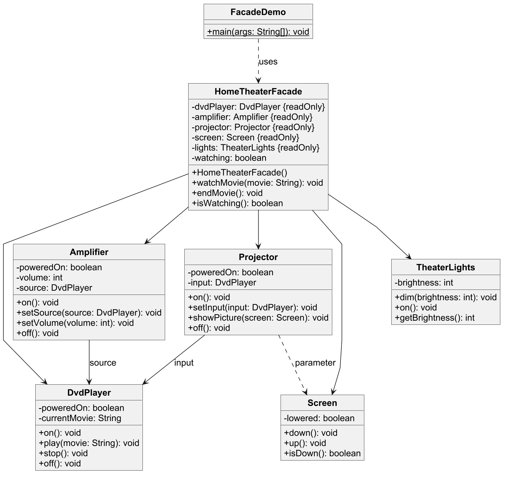

# Assignment 4 — Facade Pattern

Java 17 implementation of a Home Theater Facade for ShP-2216 Software Design Patterns.

The client starts and ends a movie through `HomeTheaterFacade`. The facade coordinates five stateful subsystem classes, including their dependencies and operation order. Console messages simulate device operations; this project does not control physical equipment.

## Pattern roles

| Role | Class | Responsibility |
|---|---|---|
| Client | `FacadeDemo` | Uses only the facade |
| Facade | `HomeTheaterFacade` | Coordinates movie startup, shutdown and failure cleanup |
| Subsystem | `DvdPlayer` | Manages power and playback |
| Subsystem | `Amplifier` | Selects a powered DVD player and validates volume |
| Subsystem | `Projector` | Requires a playing DVD source and a lowered screen |
| Subsystem | `Screen` | Tracks whether the screen is lowered |
| Subsystem | `TheaterLights` | Validates and restores brightness |

## Client API

```java
HomeTheaterFacade theater = new HomeTheaterFacade();
theater.watchMovie("Interstellar");
theater.endMovie();
```

The public API also exposes `isWatching()`. It does not accept or return subsystem objects. The default constructor assembles the components internally.

A package-private constructor accepts components for tests. It is not part of the public client API.

## Operation order

Startup lowers the screen, dims the lights, powers the DVD player, configures sound and video, starts playback and shows the picture. The amplifier and projector require a powered source. The projector also checks that the source is playing and the screen is lowered.

Shutdown stops playback before switching off the DVD player. It also switches off the projector and amplifier, raises the screen and restores full lighting. Every cleanup action is attempted even if another fails.

`DvdPlayer.stop()` clears the selected movie. Playing again requires another `play(title)` call. `DvdPlayer.off()` rejects active playback. These are deliberate rules of this model.

## Run in IntelliJ IDEA

The PNG and SVG diagrams are generated with PlantUML from `docs/facade-uml.puml`. The source can be opened in a PlantUML editor or the IntelliJ PlantUML plugin.



1. Open the project folder.
2. Select JDK 17 as the Project SDK.
3. Ensure `src` is marked as Sources Root.
4. Run `kz.aitu.sdp.facade.FacadeDemo`.

## Run in PowerShell

From the project root:

```powershell
.\run.ps1
.\verify.ps1
```

The scripts use `JAVA_HOME`, a JDK on `PATH`, or an IntelliJ-managed Java 17 installation under the user's `.jdks` directory. A JDK can also be selected explicitly:

```powershell
.\run.ps1 -JdkHome "C:\path\to\jdk-17"
.\verify.ps1 -JdkHome "C:\path\to\jdk-17"
```

Compilation uses `--release 17 -Xlint:all`. No external Java dependencies are required.

## Output

```text
Get ready to watch: Interstellar
Screen: down
Lights: brightness 10%
DVD player: on
Amplifier: on
Amplifier: DVD player selected
Amplifier: volume 5
Projector: on
Projector: DVD player selected
DVD player: playing Interstellar
Projector: showing movie on the screen
Shutting down the home theater
DVD player: stopped
Projector: off
Amplifier: off
DVD player: off
Screen: up
Lights: brightness 100%

Invalid request:
Rejected: Movie title must not be blank.
```

## Error handling and verification

Invalid movie titles are rejected before any component changes. A second movie cannot start during an active session.

If startup fails, the facade attempts shutdown and preserves the original exception as the cause. Additional cleanup failures are retained as suppressed exceptions. A failing device may remain on; the facade reports the failure rather than guaranteeing physical recovery. `endMovie()` can be called again to retry cleanup.

The standalone test runner covers 22 scenarios: valid and invalid device operations, numeric boundaries, shared object references, complete movie sessions, reuse, invalid requests, duplicate sessions, startup rollback, continued cleanup after a failure, exception preservation and default assembly.

Tests directly access subsystem classes because they verify subsystem behavior and the advanced-access property. The application client, `FacadeDemo`, creates and calls only the facade.

## Clean Code

Six principles are explained with code excerpts in the report:

1. Meaningful API and class names.
2. Single Responsibility and delegation.
3. A public facade API without subsystem types.
4. Small classes with private state.
5. Validation before state changes.
6. Failure handling that preserves causes and attempts remaining cleanup.

## Structure

```text
src/kz/aitu/sdp/facade/      7 application classes
tests/kz/aitu/sdp/facade/    standalone test runner
scripts/compile.ps1         Java compilation
run.ps1                    demonstration
verify.ps1                 verification
docs/facade-uml.png         UML diagram
docs/facade-uml.svg         vector UML diagram
docs/facade-uml.puml        PlantUML source
docs/SDP_Assignment_4_Facade_Report.docx
```

Subsystem classes have no reference to the facade. Advanced code can still instantiate and use them directly.

## Trade-offs

The facade reduces the client's dependencies but depends on the components it coordinates. It adds a layer to trace during debugging and may grow too large if unrelated features are added. Its focused API covers common movie operations; advanced operations remain available directly on subsystem classes.

## Repository

https://github.com/wwezzy/sdp-assignment-4

